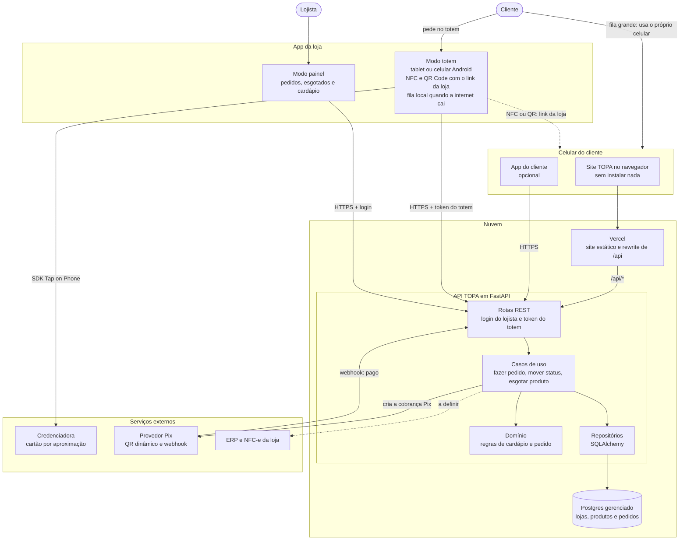

<p align="center">
  <picture>
    <source media="(prefers-color-scheme: dark)" srcset="assets/topa-logo-dark.png">
    
  </picture>
</p>

# TOPA: Totem por Assinatura

Trabalho semestral do grupo T94 em **ACH2008 - Empreendedorismo em Informática** (EACH/USP),
Prof. Luciano Vieira de Araújo, 2º semestre de 2026.

## O produto

Autoatendimento para pequenos e médios estabelecimentos de alimentação e comércio de proximidade,
entregue como serviço mensal (*Hardware-as-a-Service*), sem investimento inicial para o lojista. Roda em
tablet na vertical ou smartphone com *Tap on Phone*: Pix e cartão por aproximação no próprio aparelho,
sem maquininha externa. O pedido vai direto para a produção.

Diferenciais:

- **Recomendação por visão computacional**, que reordena a oferta conforme o contexto do cliente para
  aumentar o ticket médio.
- **Transbordo de fila** por QR Code ou NFC: no pico, o cardápio abre no celular do cliente, sem baixar
  aplicativo.
- **Operação offline** com *edge computing*, aceitando pagamentos mesmo quando a internet da loja cai.

## Entregas

| Entrega | Onde está |
| --- | --- |
| Cenários de mercado que favorecem ou desfavorecem o trabalho | [`docs/situacoes_EI_2026.pdf`](docs/situacoes_EI_2026.pdf) |
| Pitch | [`docs/Logo - Startup TOPA.pdf`](docs/Logo%20-%20Startup%20TOPA.pdf) |
| Entrevistas de validação do protótipo (em andamento) | [`entrevistas-prototipo/`](entrevistas-prototipo/) |

As tarefas do grupo estão no [GitHub Project](https://github.com/users/kaualimadesouza/projects/5).

## MVP

O MVP do totem fica em [`topa/`](topa/): [`topa/web/`](topa/web/) (Vite, React, TypeScript e
Tailwind) e [`topa/api/`](topa/api/) (FastAPI e Postgres). Os dois seguem arquitetura hexagonal. Para subir tudo na sua
máquina (precisa de Docker):

```bash
cd topa
make run    # postgres + api + web; o totem abre em http://localhost:5180
make test   # testes do web e da api
make lint
```

`make test` e `make lint` rodam direto na sua máquina (no Docker, só o Postgres dos testes da API):
precisam do Node 24 (em Node mais antigo, instale as dependências do front com `npx -y npm@11 ci`
dentro de `topa/web`) e do [uv](https://docs.astral.sh/uv/) para a API.

O front encontra a API por `VITE_API_URL`, que precisa ser do mesmo domínio (`/api`, repassado pelo
servidor do Vite), porque a API não libera CORS. Sem essa variável, o front abre em modo demonstração.

Na nuvem, o front está publicado na Vercel em modo demonstração, sem API, em
[topa-totem.vercel.app](https://topa-totem.vercel.app). Por enquanto a publicação é manual, pela
Vercel CLI: o deploy automático do CI (prévia por PR, DEV a cada push na `main` e produção a cada
release) só roda quando o repositório tiver os secrets da Vercel.

## Arquitetura final

Como o sistema fica quando sair do modo demonstração, do usuário até o banco de dados. Hoje só
o front está publicado, em modo demonstração; a API e o Postgres rodam apenas na máquina
local. O caminho até lá, fase por fase, está em
[`docs/caminho-para-producao.md`](docs/caminho-para-producao.md).



- **Cliente:** pede no totem ou, com fila, no próprio celular: encosta no totem (NFC) ou lê o QR
  Code, e a loja abre no navegador, sem instalar nada. O app do cliente é opcional.
- **Lojista:** usa o app da loja, que tem o modo totem e o modo painel, este com login.
- **API:** segue a arquitetura hexagonal do MVP. As rotas chamam os casos de uso, que aplicam as
  regras do domínio e gravam no Postgres pelos repositórios.
- **Pagamento:** o cartão passa pelo SDK *Tap on Phone* da credenciadora, no próprio totem; o Pix
  é cobrado pela API, e o provedor confirma o pagamento por webhook.
- **Setas tracejadas:** não são chamadas de rede. Uma é o link que o totem entrega ao celular; a
  outra, a integração fiscal com o ERP da loja, que ainda está a definir.

## Como compilar os documentos

Os documentos são escritos em LaTeX e compilados com `pdflatex` (TeX Live). Rode duas vezes para
resolver as referências cruzadas:

```bash
cd entrevistas-prototipo
pdflatex entrevistas_EI_2026.tex
pdflatex entrevistas_EI_2026.tex
```

Todo documento novo parte do modelo em [`docs/situacoes_EI_2026.tex`](docs/situacoes_EI_2026.tex):
mesmo preâmbulo, cabeçalho e bloco de integrantes; mudam só o título e o conteúdo.

## Integrantes

- Kauã Lima de Souza
- Kevin Rodrigues Nunes
- Luiz Felipe Couto de Souza
- Renan Biruel Uema
- Victor Yodono
