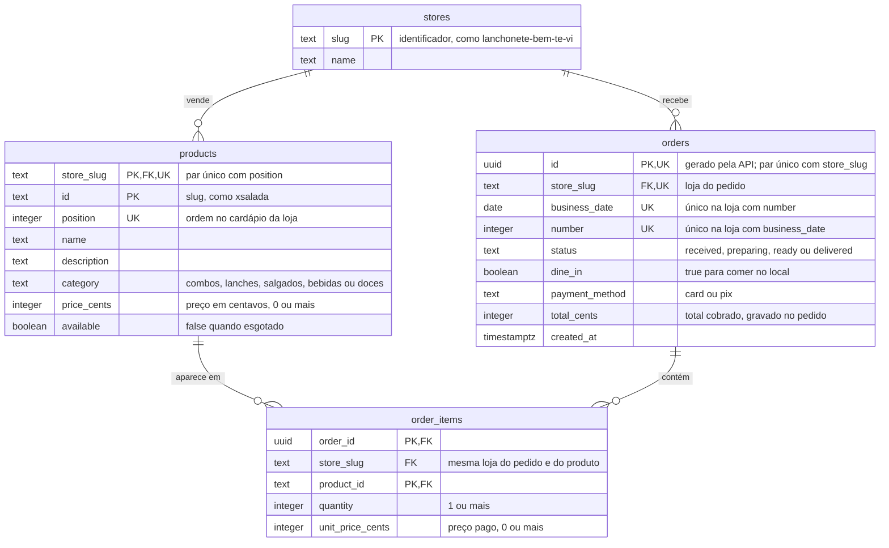

# Diagrama entidade-relacionamento (DER) do banco

O esquema do Postgres da API. A fonte da verdade é o código: os modelos em
`topa/api/src/topa_api/adapters/db/models.py` e as migrations em `topa/api/migrations/versions/`;
se este desenho divergir deles, vale o código. O teste de migrations (`alembic check`) não
compara as restrições `CHECK`: mudar `Category`, `OrderStatus` ou `PaymentMethod` pede uma
migration escrita à mão, como a `7db80bf0a5ff`.

## O que o desenho não mostra

- Todas as colunas são `NOT NULL`. O banco recusa, por `CHECK`, `category`, `status` e
  `payment_method` fora das listas acima, `price_cents` e `unit_price_cents` negativos e
  `quantity` menor que 1. `total_cents` não tem `CHECK`.
- `store_slug` tem valor padrão `'lanchonete-bem-te-vi'` em `products`, `orders` e `order_items`
  para manter compatibilidade com uma versão anterior da API enquanto uma migration roda.
- `orders` declara `(id, store_slug)` como par único para que `order_items` referencie tanto
  `(order_id, store_slug)` quanto `(store_slug, product_id)` por chave estrangeira composta,
  impedindo no banco que um pedido aponte para produto de outra loja.
- O `id` do produto também é o nome da foto: `topa/web/public/photos/<id>.jpg`.
- `position` dá a ordem do cardápio de cada loja e também a dos itens que a API devolve em cada
  pedido; a ordem em que o cliente tocou nos produtos não é guardada.
- `business_date` é a data de `created_at` em São Paulo, e `number`, o número que o cliente vê,
  recomeça em 1 a cada `business_date` em cada loja.
- `unit_price_cents` é uma cópia do preço na hora da compra: mudar o preço do produto não altera
  pedidos antigos.
- Como a chave de `order_items` é o par (`order_id`, `product_id`), a API junta as repetições
  de um produto num item só, somando a `quantity`.
- Apagar um pedido apaga os itens (`ON DELETE CASCADE`); apagar um produto que já foi pedido é
  recusado.
- Não há estado de pagamento: o pagamento ainda é simulado, e o app grava o pedido ao pagar.
- O Alembic mantém também a tabela `alembic_version`, com a revisão aplicada.

Só a API, e não o banco, impõe estas regras (detalhes em
[`topa/api/README.md`](../topa/api/README.md)):

- recusa pedido sem itens e produto esgotado;
- limita as unidades de cada produto por pedido;
- tira o preço do cardápio, nunca do corpo da requisição;
- move o status um passo por vez, para a frente ou para trás.

O que muda no esquema nas próximas fases está em
[`caminho-para-producao.md`](caminho-para-producao.md).
