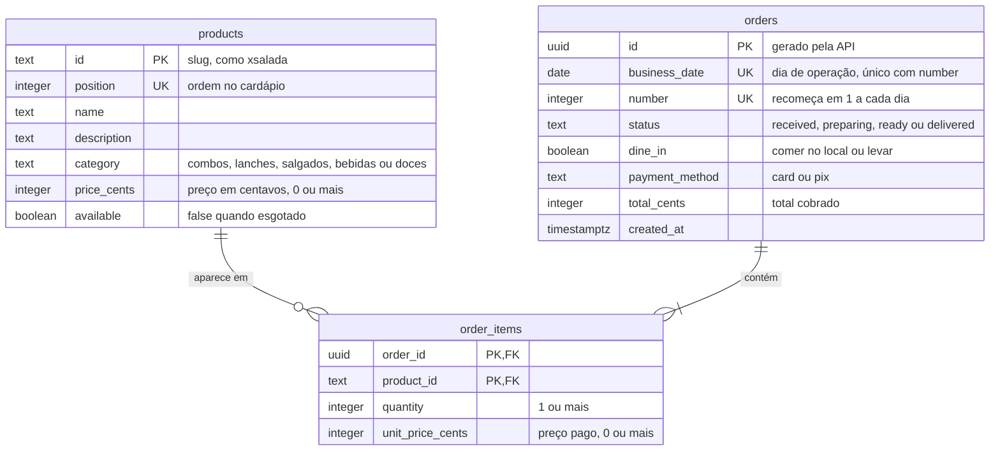

# DER do banco de dados

O banco da API do TOPA: Postgres, com o esquema criado pelas migrations do Alembic em
`topa/api/migrations/versions/`. No deploy, ele roda no Neon, e o workflow da API aplica as
migrations antes de cada versão (`topa/api/infrastructure/README.md`); na máquina, roda no
Postgres do `docker-compose.yml`. A fonte da verdade são os modelos em
`topa/api/src/topa_api/adapters/db/models.py`, que um teste compara com as migrations
(`alembic check`, em `topa/api/tests/integration/test_migrations.py`).

São três tabelas: o cardápio (`products`), os pedidos (`orders`) e os itens de cada pedido
(`order_items`), que ligam as duas primeiras.

Todas as colunas são `NOT NULL`. As restrições seguem a convenção de nomes de
`topa/api/src/topa_api/adapters/db/base.py` (`pk_products`, `uq_orders_business_date_number`,
`ck_orders_status`, `fk_order_items_order_id_orders`), para que uma migration futura possa
alterá-las pelo nome.

## Tabelas

**`products`**: um produto do cardápio. A chave é um slug legível (`xsalada`, `combo-cafe`),
que o app também usa para achar a foto (`topa/web/public/photos/<id>.jpg`). `position` é única
e dá a ordem de exibição. `category` só aceita as cinco categorias do domínio, e `available`
falso marca o produto como esgotado sem apagá-lo. A primeira migration já grava os 18 produtos
do cardápio de demonstração.

**`orders`**: um pedido pago. O `id` é um UUID gerado pela API; o número que o cliente vê é
`number`, que recomeça em 1 a cada dia de operação, contado no fuso `America/Sao_Paulo`
(`business_date`). A restrição única é o par (`business_date`, `number`), não cada coluna
sozinha. O banco só confere que `status` é um dos quatro valores; quem faz o pedido andar um
passo por vez, para a frente ou para trás (`received`, `preparing`, `ready`, `delivered`), é a
API. `total_cents` guarda o total cobrado, a soma de `quantity` vezes `unit_price_cents` dos
itens, gravado junto com o pedido. A API não lê essa coluna de volta: as respostas recalculam o
total a partir dos itens.

**`order_items`**: um produto dentro de um pedido. A chave é o par (`order_id`, `product_id`),
então um produto aparece uma vez por pedido: a API junta as repetições somando a `quantity`.
`unit_price_cents` é uma cópia do preço no momento da compra, para que mudar o preço do
produto não altere pedidos antigos.

## Relações

| De | Para | Cardinalidade | O que acontece ao apagar |
|---|---|---|---|
| `order_items.order_id` | `orders.id` | um pedido tem um ou mais itens | apagar o pedido apaga os itens (`ON DELETE CASCADE`) |
| `order_items.product_id` | `products.id` | um produto aparece em nenhum ou vários itens | o banco recusa apagar um produto que já foi pedido |

O banco aceitaria um pedido sem itens; quem recusa é a API, com 422. O limite de 20 unidades
de cada produto por pedido, contado depois de juntar as repetições, também é regra da API: o
banco só exige `quantity` de 1 ou mais.

Além das três, o Alembic mantém a tabela `alembic_version`, com a revisão aplicada.

## O que muda nas próximas fases

O caminho está em [`caminho-para-producao.md`](caminho-para-producao.md):

- **Login do lojista (fase 1, item 4):** onde guardar os lojistas e o login deles, dado pessoal
  que já entra na LGPD.
- **Cardápio real (fase 1, item 5):** onde guardar a foto do produto (hoje o banco não tem
  coluna de foto) e categorias editáveis, hoje uma lista fixa presa por uma restrição `CHECK`.
- **Várias lojas (fase 2):** uma tabela de lojas; produtos e pedidos passam a ter a loja, e a
  numeração diária passa a ser por loja.
- **Vender sem internet (depois das fases, item 5):** cada totem numera com um prefixo próprio
  (A01, B01), o que muda `number` e a restrição única do dia.
